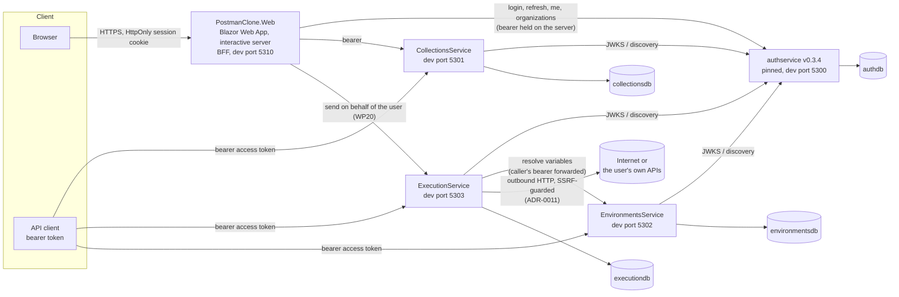

# Architecture

This page describes the system as it is on `main` at the end of WP27. Where a part is planned and not
built, it says so. The decisions behind the shape are in [`decisions/`](decisions/README.md); the
contracts are in [`implementation-plan/CONTRACTS.md`](implementation-plan/CONTRACTS.md); the
rules the tests enforce are in [ADR-0020](decisions/0020-architecture-fitness-tests.md).

## 1. Topology



Everything in the cluster is declared in `src/PostmanClone.AppHost` (P1), which needs Docker. One PostgreSQL
server holds four service databases, and authservice has its own (`authdb`). The no-Docker route
(`scripts/run-local-stack.sh`) runs the same services as processes on fixed ports; see
[OPERATIONS.md](OPERATIONS.md#4-running-locally).

The Web's builder sends through ExecutionService (WP19 and WP20). The Web's list of services and their discovery names are in `Api/BackendServices.cs`.

## 2. Bounded contexts and data ownership

| Owner | Holds | Personal data | Source of truth for |
|---|---|---|---|
| authservice (external, pinned) | users, credentials, organizations, memberships, refresh tokens, invitations, consents, audit events | yes (see [PRIVACY.md](PRIVACY.md)) | identity, workspace membership, roles |
| CollectionsService | collections, folders, saved requests (`RequestDefinition` as `jsonb`) | user ids, user-written content | the document model |
| EnvironmentsService | environments, variables; secret values encrypted (AES-256-GCM, ADR-0006) | user ids, non-secret values | variable sets and secret custody |
| ExecutionService | sender state, history entries (masked) | user ids, masked request and response | the outbound capability and history |
| PostmanClone.Web | nothing persistent; sessions and open state in memory (ADR-0005, ADR-0008) | none stored | the browser boundary |

Each database has one owner (P3). No service reads another service's database; the architecture tests
check that no service project references another (R2), and the services talk only over HTTP with the
contracts in CONTRACTS §2–§4.

## 3. Workspace and tenancy

A **workspace is an authservice organization** (ADR-0004). The workspace is read from the access token and
from nowhere else:

- The kernel's `WorkspaceClaims` reads the single `organization` claim and the role in
  `organization:{id}:role`. Zero or two or more organizations resolve to `None` or `Multiple`, and the
  domain endpoints answer `403 no_active_workspace` or `403 multiple_workspaces` (fail closed).
- `RequireActiveWorkspace` is an endpoint filter on every domain group (CollectionsService, EnvironmentsService,
  ExecutionService history and execute).
- Every endpoint with an `{id}` loads the row, compares its workspace and answers `404 not_found` when it is
  absent or belongs to another workspace (never `403`). Each such endpoint has a scoping test named
  `Scoping_<METHOD>_<route>`; the architecture test R6 enumerates the routes and fails when one has no test.

## 4. Browser boundary and sign-in (BFF)

ADR-0005 keeps tokens out of the browser. The Web is a backend-for-frontend: the browser holds one
HttpOnly cookie that carries a random id, and the access and refresh tokens stay in the server-side session
store.

```mermaid
sequenceDiagram
  autonumber
  participant B as Browser
  participant W as Web (BFF)
  participant S as ServerSessionStore
  participant A as authservice

  B->>W: GET /sign-in
  W-->>B: 200 form with antiforgery token
  B->>W: POST /sign-in (form, antiforgery token)
  Note over W: Origin guard runs first. The browser sends a real Origin because<br/>Referrer-Policy is same-origin (ADR-0022); OI-01 is fixed.
  W->>A: POST /api/v1/auth/login {email, password}
  A-->>W: 200 TokenResponse (access + refresh)
  W->>W: verify the access token signature against authservice JWKS
  W->>S: store tokens and claims under a random 256-bit id
  W-->>B: 302 / with Set-Cookie __Host-pc.session (HttpOnly, SameSite=Strict, Secure)
  Note over W,S: Later requests: the cookie selects the session.<br/>Access token refreshed when < 2 min remain (single-flight, rotating refresh).<br/>Circuits re-check the session every 5 min. Idle 8 h, absolute 7 days (ADR-0013).
```

Sign-out (`POST /sign-out`) calls authservice logout, which revokes every refresh token of that user (not only
the current one, see [AUTH.md](AUTH.md#differences-from-contracts-6)), then clears the cookie.

Other browser-side rules, all implemented: an origin guard before antiforgery, a Content-Security-Policy that
allows only `'self'`, `X-Frame-Options: DENY`, `X-Content-Type-Options: nosniff`, `Referrer-Policy: no-referrer`
(same-origin since ADR-0022; `no-referrer` caused OI-01), no JavaScript interop, no `localStorage` or `sessionStorage` (verified by search).

## 5. Send flow: `POST /api/v1/execute`

ExecutionService is the only service with an outbound network capability (ADR-0003), so its path is the
one most worth reading.

```mermaid
sequenceDiagram
  autonumber
  participant C as Caller (an API client, or the Web for the signed-in user)
  participant X as ExecutionService
  participant E as EnvironmentsService
  participant G as GuardedConnector (SSRF guard)
  participant T as Target host
  participant H as History

  C->>X: POST /api/v1/execute {request, environmentId?, timeout, followRedirects}
  Note over X: JWT verified, one active workspace (RequireActiveWorkspace),<br/>rate limit "execute" (60/min per user)
  opt environmentId given
    X->>E: POST /api/v1/environments/{id}/resolve (caller's bearer)
    E-->>X: enabled variables, secrets in plaintext
    Note over E,X: 404 becomes not_found; EnvironmentsService down becomes 502 upstream_unavailable
  end
  X->>X: assemble: interpolate once, build URL, headers, body, auth<br/>limits: body 1 MB, 100 headers, URL 8192
  X->>X: validate target: http/https only, no userinfo, blocked ports,<br/>literal IP forms normalized before the check
  loop each hop (at most 5 redirects, manual loop)
    X->>G: connect to host:port
    G->>G: resolve DNS itself, check every answer against the block list
    alt any answer blocked
      G-->>X: refuse (blocked, ssrf_blocked_address)
    else all allowed
      G->>T: dial one checked address only (pinned for this connection)
      T-->>X: response headers and body
      X->>X: read body up to 5 MB, decode Content-Encoding within the cap
    end
    Note over X: 301/302/303 become GET; 307/308 keep method and body.<br/>Each Location is re-validated as a new target.
  end
  X->>X: mask finalUrl, response headers and body (SecretMasker)
  X->>H: record masked request template and masked result (body <= 64 KB)
  X-->>C: 200 ExecutionResult {outcome, response, timing, finalUrl, redirects, historyId}
```

Defence in depth for the outbound path:

| Layer | Where | What it stops |
|---|---|---|
| Limits on size, count, time and redirects | `ExecutionOptions`, `RequestExecutor` | exhaustion; the defaults are CONTRACTS §4 |
| Target validation before any socket | `Sending/Ssrf/TargetValidator` | non-http schemes, userinfo, blocked ports, literal-IP tricks (decimal, octal, hex) |
| Resolve and check at connect | `Sending/Ssrf/GuardedConnector` via `SsrfHandlerFactory` | DNS rebinding, private or metadata addresses in any answer |
| Connection pinned to the checked address | `GuardedConnector` (dials only checked addresses) | a second DNS answer between check and use |
| Manual redirects, each re-validated | `RedirectPlanner`, `RequestExecutor` | redirects to internal addresses; credentials dropped on a cross-host hop |
| No ambient proxy, no cookies, no auto-redirect, no auto-decompression | `SsrfHandlerFactory` | proxy bypass, cookie carry-over, hidden redirects |
| Startup refusal of relaxed settings outside Development | `ExecutionOptionsValidator` | `AllowLoopback` or `AllowPrivateRanges` outside Development |
| Network egress policy (not in this repository) | deployment | the real backstop; the owner must provide it (ADR-0011) |

The loopback and private-range relaxations exist for the test suite and the local stack. The default is
`enforced`, and `/health` reports it (`ssrfProtection`).

## 6. Import flow

The Web's `/import` page (WP23) posts the file or the cURL command to CollectionsService with the signed-in
user's token, held on the server. `/requests/{id}/curl` shows the cURL of one request, and
`GET /download/collections/{id}` is the Web's authorized download of a collection's Postman file (ADR-0021).
The service's own rules apply to every upload, whichever client sends it.

```mermaid
flowchart TD
  U[Upload: Postman v2.1 file<br/>or cURL command] --> S{size}
  S -- "over 5 MB, or over 20000 chars" --> R1[413 import_too_large or 400]
  S -- ok --> P{parse}
  P -- "not UTF-8, not JSON, depth over 64,<br/>wrong types" --> R2[400 import_invalid, names each path]
  P -- "cURL: tokenizer, never a shell" --> W[walk: at most 20 folder levels,<br/>at most 5500 items, folder depth flattened to 8]
  W --> L[literals replaced by generated {{variables}}<br/>warning secret_not_imported, value never stored]
  L --> X[scripts, variables, unsupported bodies and auth<br/>dropped with a named warning]
  X --> V[RequestDefinitionValidator, the same rules as the API]
  V -- any rule broken --> R3[refuse the whole file: nothing written]
  V -- ok --> T[one transaction: collection, folders, requests<br/>workspace collection limit 200 under lock]
  T --> OK[201 ImportResult with counts and grouped warnings]
```

Export is the reverse: `GET /api/v1/collections/{id}/export/postman` writes a deterministic v2.1 file, and
`GET /api/v1/requests/{id}/export/curl` writes a POSIX-quoted command whose values that were `{{var}}` stay
`{{var}}`. The threat model is [ADR-0016](decisions/0016-import-threat-model.md).

## 7. Secret flow

```mermaid
flowchart LR
  W1[PUT environment<br/>VariableWrite isSecret=true] --> EN[AES-256-GCM encrypt<br/>AAD = workspace|environment|key<br/>stored as v1: ciphertext]
  EN --> DB[(environmentsdb<br/>ciphertext only)]
  DB -. "GET never returns a secret" .-> UI[responses: value null, hasValue true]
  DB --> RS[resolve, internal call only<br/>plaintext, enabled variables]
  RS --> AS[assembly substitutes once]
  AS --> SENT[sent to the target]
  AS --> MK[SecretMasker: finalUrl, headers, body]
  MK --> HIST[(history: template with {{refs}},<br/>masked result)]
  MK --> RESP[response to caller: masked]
  AS -. "logs: host, status, sizes, durations only" .-> LOG[logs]
```

Auth-helper fields accept only `{{variable}}` references (`secret_literal_not_allowed` otherwise). History
keeps the template, so a stored request never contains a secret value. The masking rules are in
CONTRACTS §4 and ADR-0012 (encoded forms), ADR-0015 (history). A body cut by the 5 MB read cap keeps its
secrets masked: the incomplete tail and any partial secret at the cut are removed before masking (WP28, OI-12).
The sender's outbound requests are not traced, so a user's target never reaches a span (ADR-0019).

## 8. Architecture rules as tests

[ADR-0020](decisions/0020-architecture-fitness-tests.md) makes ten rules mechanical in
`tests/PostmanClone.ServiceDefaults.Tests/Architecture/`:

| Rule | Checks |
|---|---|
| R1 | the kernel references no domain type |
| R2 | no service references another service project or its database context |
| R3 | the Web references only the kernel |
| R4 | each manifest is at most 150 lines and calls `AddServiceDefaults` and `MapDefaultEndpoints` |
| R5 | every route is authorized, or is on the short anonymous list (`/health`, `/alive`, sign-in, register, sign-out, legal pages) or a framework endpoint |
| R6 | every `{id}` route has a `Scoping_` test |
| R7 | `EnsureCreated` is only on the InMemory branch |
| R8 | each Dockerfile: runtime major equals the target major, `EXPOSE 8080`, a non-root `USER` |
| R9 | the standard resilience handler is added once, in the kernel |
| R10 | package versions are exact |

Each rule is shown to fail on a broken sample held in memory.

## 9. Repository layout

The directory tree is in [README.md](../README.md#repository-layout). The kernel is
`src/PostmanClone.ServiceDefaults` (756 of 800 allowed lines, checked by `scripts/check-kernel-size.sh`).
