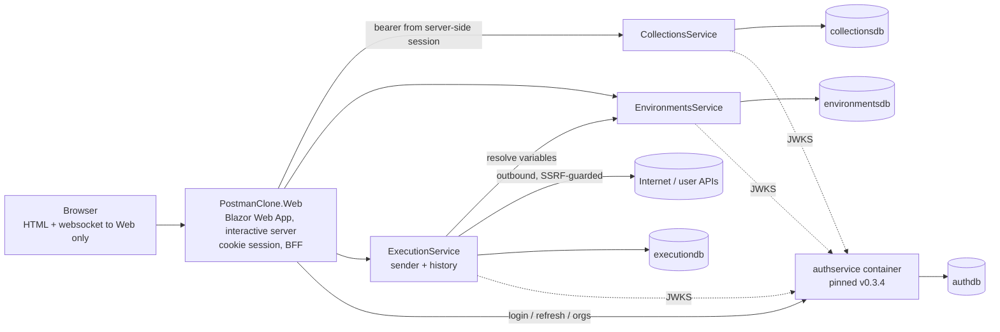

# postman-clone — implementation plan

An API client in the spirit of Postman, written from scratch as a **Blazor Web App
(interactive server, no WebAssembly, no Node)**, signed in through the external
[`authservice`](https://github.com/konradcinkusz/authservice), composed by an **Aspire AppHost**,
and built to [`architecture-standards`](https://github.com/konradcinkusz/architecture-standards)
(P1–P15 plus the guides named in [PROTOCOL.md](PROTOCOL.md)).

This directory is the single source of truth for the build:

| File | What it is |
|---|---|
| `README.md` (this file) | Product scope, architecture, decisions, wave plan, risks |
| [`CONTRACTS.md`](CONTRACTS.md) | Frozen HTTP contracts, claims, limits, error codes |
| [`PROTOCOL.md`](PROTOCOL.md) | The rules every sub-session follows (environment, git, CI, merge, final message) |
| [`WORK-PACKAGES.md`](WORK-PACKAGES.md) | WP00–WP33: scope, dependencies, acceptance criteria, reserved ADR numbers (WP29–WP33 are the local agent and the Fly estate, ADR-0026) |

The build is run by a **supervisor session** (planning, spawning, checking, archiving only — it
writes no product code) and **autonomous Haiku 5.5 sub-sessions**, one per work package. Each
sub-session opens its own PR, waits for CI, and squash-merges it.

---

## 1. Product scope

**In scope**

| Area | What the user gets |
|---|---|
| Sign-in | Register / sign in / sign out through authservice. Cookie session on the web host; tokens never reach the browser |
| Workspaces | A workspace is an authservice **organization**. All members of the organization see the same collections and environments (this is the "sharing") |
| Collections | Collections → nested folders (max depth 8) → saved requests; create / rename / move / duplicate / delete |
| Request builder | Method, URL, query params, headers (each row enable/disable), body (none, raw json/text/xml/html/javascript, form-urlencoded, form-data **text fields**), auth helpers (none, bearer, basic, API key in header or query) |
| Environments | Named variable sets per workspace, `{{name}}` interpolation, **secret variables** (encrypted at rest, masked in UI, history and logs) |
| Sender | Requests executed **server-side** by ExecutionService with SSRF protection, size and time limits (public URLs). *Superseded in part by ADR-0026:* requests to local and private targets are sent by the user's **local agent** (planned WP30–WP32), with the same masking and caps |
| Response viewer | Status, time, size, headers, body (pretty JSON / raw / "binary, N bytes"), truncation notice, timing breakdown, redirect chain |
| History | Per-user request history (secrets masked), re-open into the builder, delete, clear, bounded retention |
| Import / export | Import Postman Collection v2.1 JSON and cURL commands; export a collection as Postman v2.1 JSON and a request as cURL |

**Out of scope** (each recorded in ADR-0001; do not build, do not stub)

Mock servers, monitors, scheduled runs, collection runner / test scripts (`pre-request`,
`tests` JS is *ignored and reported on import*), GraphQL / gRPC / WebSocket / SSE clients,
file upload in form-data, cookies jar, proxy settings, client certificates, OAuth 2.0 flows
(only the four auth helpers above), public sharing links, cloud sync beyond the workspace,
collaboration cursors / live co-editing, per-collection variables and global variables
(environment variables only), per-resource ACLs or viewer roles (authservice has only
Owner / Admin / Member), two-factor sign-in (authservice supports it; the Web shows "not
supported yet"), keyboard shortcuts that need JS interop, billing. **Deployment** was out of scope under ADR-0007; that is superseded for this product by ADR-0026 (a manual Fly.io workflow, WP33). The local agent is in scope (WP29–WP32).

## 2. Architecture



**Planned change (ADR-0026, 2026-11-01):** the diagram above shows the server path, which stays for public URLs. Requests to local and
private targets go from the browser to a **local agent** on the user's computer (`127.0.0.1` only, checked Origin, Host and pairing token),
and the agent takes its resolved values straight from EnvironmentsService (agent routes, CONTRACTS A2). The shared estate is to be deployed
to Fly.io by a manual workflow (WP33).

Everything is declared in `PostmanClone.AppHost` (P1). One PostgreSQL server, **five logical
databases** (one per owner, P3). Services and Web all call `AddServiceDefaults()` (P2a).

### Bounded contexts (P3, P4)

| Service | Owns | Why separate |
|---|---|---|
| **CollectionsService** (`collectionsdb`) | collections, folders, saved requests, import/export | The core document model; high read volume; no secret material (auth helper fields hold `{{variable}}` references only) |
| **EnvironmentsService** (`environmentsdb`) | environments, variables, **encrypted secrets**, the encryption key | Secret lifecycle and key custody get their own blast radius and their own audit log; P3 "data cohesion": variables are read together, always per environment |
| **ExecutionService** (`executiondb`) | sender, request history | Carries the only **outbound network capability** and untrusted response bodies. A separate service means a separate failure/egress domain — the `JudgeAgent` argument of P10 ("a new dependency that drags a risk behind it becomes a service"). It calls EnvironmentsService over HTTP for variables, never its database |
| **PostmanClone.Web** | nothing persistent | BFF + UI. Holds sessions in memory (ADR-0008) |
| **authservice** (external) | users, organizations, tokens | Adopted as the only IdP. Pinned image, **never copied into this tree** |

No event bus (reference architecture §4). All cross-service calls are synchronous HTTP against
[CONTRACTS.md](CONTRACTS.md). Web DTOs are **copies** guarded by round-trip tests.

### Key decisions (expanded into ADRs by WP00; numbers are reserved, see WORK-PACKAGES.md)

| ADR | Decision |
|---|---|
| 0001 | Product scope and non-goals (§1) |
| 0002 | Blazor Web App, interactive server, over Next.js: BLAZOR-WEB-APP §1 row "Internal tools / .NET-only team"; WASM rejected |
| 0003 | Three domain services + Web, database per service; the Execution split justified by the outbound capability |
| 0004 | authservice is the only IdP. Workspace = the single `organization` claim. 0 organizations → onboarding (create via authservice `POST /api/v1/organizations`, then refresh to get the claim); ≥2 → **fail closed** with an explanation page. No workspace switcher exists (authservice issues no organization-scoped token). Limitations documented in `docs/AUTH.md` |
| 0005 | BFF session: HttpOnly `SameSite=Strict` cookie holds only a random session id; ticket and token pair live in a server-side store; refresh is serialized per session (rotating single-use refresh tokens); circuits revalidated every 5 minutes |
| 0006 | Secrets: environment secrets AES-256-GCM at rest (AAD binds workspace, environment, key); auth-helper secret fields accept `{{variable}}` references only; secrets masked in UI/history/logs; `resolve` is not a confidentiality boundary against workspace members (same as Postman) |
| 0007 | Deployment out of scope (no Fly.io artifacts, no tags, no repo settings) — superseded for this product by 0026 |
| 0026 | Local agent sends requests to local and private targets; Fly hosts the shared estate; opaque agent credentials; secrets reach the agent (accepted); deployment by hand only |
| 0008 | Web keeps sessions and open tabs in server memory, runs as a single instance; restart = sign in again |
| 0009 | Dependency budget: ASP.NET Core shared framework only in Web; no component/chart library, no JS interop packages, no CSS framework |

### Roles inside a workspace (from the `organization:{id}:role` claim)

| Action | Member | Admin / Owner |
|---|---|---|
| Read everything in the workspace | yes | yes |
| Create / edit collections, folders, requests, environments | yes | yes |
| Delete a collection or environment | only if creator | yes |
| Write a **secret** variable value | yes | yes |
| Invite members (via authservice) | no | yes |
| Execute requests, see own history | yes | yes (own only; nobody sees another user's history) |

## 3. Repository layout (WP00–WP03 create it)

```
PostmanClone.sln   global.json   Directory.Build.props   Directory.Packages.props
src/
  PostmanClone.AppHost/            composition root, dev only (P1)
  PostmanClone.ServiceDefaults/    kernel, <= 800 lines, no entities/DTOs (P2)
  PostmanClone.CollectionsService/
  PostmanClone.EnvironmentsService/
  PostmanClone.ExecutionService/
  PostmanClone.Web/                Blazor Web App
tests/
  PostmanClone.TestKit/            shared helpers (TestTokens, PostgresFixture, FakeHandlers)
  PostmanClone.ServiceDefaults.Tests/   incl. architecture tests
  PostmanClone.CollectionsService.Tests/  EnvironmentsService.Tests/  ExecutionService.Tests/
  PostmanClone.Web.Tests/          bUnit + WebApplicationFactory + file-reading pins
  PostmanClone.E2E/                Playwright (.NET), own CI job
docs/  implementation-plan/  decisions/  architecture/DEVIATIONS.md  AUTH.md  ARCHITECTURE.md
scripts/  run-local-stack.sh  gen-dev-secrets.sh  install-hooks.sh  check-kernel-size.sh
.github/  workflows/{pr-validation,secret-scan}.yml  CODEOWNERS  dependabot.yml  pull_request_template.md
.claude/settings.json            enables architecture-core@architecture-standards
```

Local ports for `scripts/run-local-stack.sh` (also the launch-profile ports): authservice
`5300`, CollectionsService `5301`, EnvironmentsService `5302`, ExecutionService `5303`, Web `5310`,
PostgreSQL `5432`. Under the AppHost ports float except where a contract fixes them.

## 4. Security-sensitive areas (get a dedicated test list and ADR each)

1. **Sender / SSRF** (WP10, WP14): scheme allow-list, DNS resolved by us, every address checked
   against the block list, connection pinned to the validated address (rebinding), redirects
   followed manually and re-validated, body/time caps, no ambient proxy, no cookies.
2. **Secret variables** (WP09, WP14, WP20, WP21): encrypted at rest, masked everywhere, never
   logged, never in a URL, never persisted in history.
3. **Imported collections** (WP16, WP17): untrusted input — size/depth/count caps, no script
   execution, no shell, no network on import.
4. **Tenant isolation** (every API WP, WP25): workspace from the token only, 404 not 403,
   scoping test per endpoint, matrix test enumerating routes.
5. **Browser boundary** (WP07, WP12): origin guard, no tokens in JS or persisted component state,
   antiforgery on form posts, security headers.

## 5. Execution plan

Waves are indicative; the supervisor's rule is: **start a WP when all its dependencies are merged
and green on `main` and fewer than 4 sessions are running.**

| Wave | Work packages (parallel within a wave) |
|---|---|
| 1 | WP00 |
| 2 | WP01 |
| 3 | WP02, WP03 |
| 4 | WP04, WP05, WP06, WP07 |
| 5 | WP08, WP09, WP10, WP11 |
| 6 | WP12, WP13, WP14 |
| 7 | WP15, WP16, WP17, WP18 |
| 8 | WP19, WP23, WP24, WP25 |
| 9 | WP20 |
| 10 | WP21, WP22 |
| 11 | WP26, WP27 |
| 12 | WP28 (architecture-review + security-review, fixes) |
| 13 | WP29 (local agent and Fly decided: ADR-0026, CONTRACTS A2) |
| 14 | WP30 (agent program and the server routes it needs), WP33 (Fly, manual deploy) |
| 15 | WP31 (Web: pairing, status, Send choice, one script) |
| 16 | WP32 (E2E with the real agent and its refusals) |

Dependency graph: see the table in [WORK-PACKAGES.md](WORK-PACKAGES.md#dependency-table).

## 6. Known limits and what cannot be verified in sub-sessions

- **No Docker daemon** in sessions: the AppHost cannot be run live. CI has a `docker-build` job
  (builds every Dockerfile) and the AppHost is only build-checked. Every WP says what it ran.
- E2E runs against `scripts/run-local-stack.sh` (PostgreSQL + `dotnet run`, authservice built
  from its pinned tag) — not through Aspire.
- Real internet egress from the sender can only be tested against a loopback target started by the
  tests, with `Execution:Ssrf:AllowLoopback=true` (refused to start in `Production`).
- authservice facts (verified against v0.3.4 source when this plan was written; WP03 re-verifies):
  `POST /api/v1/auth/login|register|refresh|logout`, `GET /api/v1/auth/me`,
  `GET /api/v1/auth/consents/versions`, `POST /api/v1/organizations` (creator becomes Owner),
  `POST /api/v1/organizations/{id}/invite`, `POST /api/v1/organizations/invitations/accept`;
  access token claims `sub`, `email`, `jti`, `name`, `role` (system roles), `organization`
  (one per membership) and `organization:{id}:role`; **no** `workspace` claim, no
  organization-scoped token, no workspace-switch endpoint. RS256 + `/.well-known/jwks.json` when
  `Jwt__PrivateKeyPem` is set. *The supervisor's brief said there is no create-organization
  endpoint; the pinned source has one — WP03/WP12 verify and `docs/AUTH.md` records the truth.*
- Image `ghcr.io/konradcinkusz/authservice:v0.3.4` must be pullable by CI and developers; if it is
  private, the owner must grant access (owner action).

## 7. Owner actions (collected by the supervisor, repeated in the final report)

Branch protection / required checks on `main`, enabling CodeQL and Dependabot alerts, GitHub
secret-scanning push protection, deleting merged `wp/*` branches (sessions cannot), reviewing
`CODEOWNERS`, supplying production secrets and the Fly token (`FLY_API_TOKEN`, ADR-0026), registering
SendGrid/OAuth in authservice if wanted.
